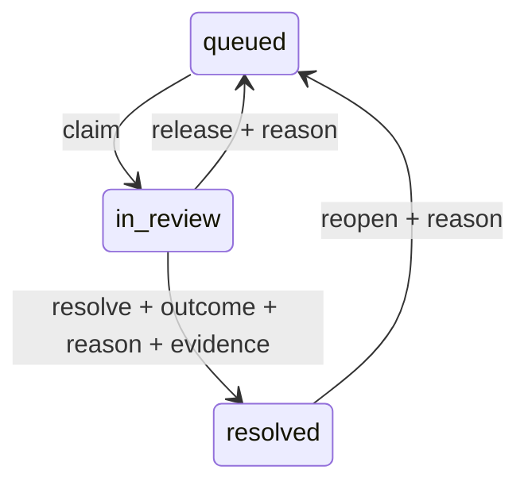

# 从风险清单到人工复核闭环

业务问题不是“能不能导出高风险客户”，而是清单导出后，谁来处理、处理依据是什么、两个人同时认领会不会互相覆盖，以及网络重试会不会重复记一次结论。

CreditVintage 的 `analyze` 仍负责回溯评估；新增 SQLite 工作区只保存它核验后的**无未来标签复核清单**和人工操作事件。两条路径分开：历史事件捕获率属于模型分析，完成率属于工作处理。人工 `cleared` 不等于客户将来不会逾期；`escalated` 也不等于确认违约。

## 五分钟运行

在仓库根目录完成 README 中的安装后，用一个尚不存在的输出目录：

```powershell
.\.venv\Scripts\creditvintage.exe analyze docs/demo --out outputs/review-example
.\.venv\Scripts\creditvintage.exe review-init outputs/review-example --db outputs/reviews.sqlite
$caseId = (Import-Csv outputs/review-example/review_queue.csv)[0].application_id
.\.venv\Scripts\creditvintage.exe review outputs/reviews.sqlite $caseId claim --actor alice --version 0 --request-id demo-claim-1
.\.venv\Scripts\creditvintage.exe review outputs/reviews.sqlite $caseId resolve --actor alice --version 1 --request-id demo-resolve-1 --outcome escalated --note "Synthetic income document needs a second review" --evidence "synthetic-doc:income-001"
.\.venv\Scripts\creditvintage.exe review-status outputs/reviews.sqlite
```

`$caseId` 是任务变量，不是系统变量。两个审核人姓名和材料引用都是演示值，并不宣称已接入真实银行。

完成上述步骤后，48 条样例中应有 47 条 `queued`、0 条 `in_review`、1 条 `resolved`；升级 1 条，处理完成率为 **1/48**。这与历史报告里的 **25/48 复核精确率**、**25/107 事件捕获率**不是同一个指标。重复执行相同的 `resolve` 命令，返回 `replayed`，事件数仍为 2。

Linux/macOS 可把取第一条编号的步骤写成：

```bash
case_id=$(python -c 'import csv; print(next(csv.DictReader(open("outputs/review-example/review_queue.csv", encoding="utf-8")))["application_id"])')
creditvintage review outputs/reviews.sqlite "$case_id" claim --actor alice --version 0 --request-id demo-claim-1
```

其余命令使用同一编号。已存在的工作区不会被初始化命令覆盖；再次演示时使用新的输出目录与数据库名。

## 状态和业务约束



| 操作 | 前置条件 | 必留信息 |
| --- | --- | --- |
| `claim` | 当前为 queued；版本匹配 | 操作者、请求 ID |
| `release` | 当前为 in_review；本人是 owner；版本匹配 | 释放原因 |
| `resolve` | 当前为 in_review；本人是 owner；版本匹配 | cleared/escalated、原因、材料引用 |
| `reopen` | 当前为 resolved；版本匹配 | 重开原因；清空当前 owner 和 outcome |

每个成功操作使该案例的 `version` 加 1。重开保留旧结论事件，新的认领与结论继续追加。理由为空、引用为空、越过认领直接结案、他人结案、编号不存在或旧版本提交都失败，事件数不变。

材料引用是一个可追踪字符串，不会自动读取或验证材料内容。CLI 的 `--actor` 是可信本地工作区里的操作者声明，**不是身份认证**。真实多人系统需要服务端身份、角色授权和受控附件存储。

## 为什么这样设计

**用 SQLite，而不是先搭分布式系统。** 这个工作流需要落盘、原子写入和互斥认领，标准库 SQLite 足够复现这些约束。写入先 `BEGIN IMMEDIATE`，在同一个事务里读取历史、检查版本、追加事件。两人同时以 version 0 认领，只能一人成功，另一人得到当前版本冲突；不用“最后一次保存覆盖前一次”。锁等待超时会明确失败，可按同一请求 ID 重试。

**请求 ID 解决重试，版本解决冲突。** 已接受的请求 ID 携带完全相同内容时返回原事件，即使案例后来又变了也不再次执行。相同 ID 携带不同操作者、原因或动作则拒绝。一个新请求携带旧版本也拒绝。两个机制解决不同问题，不能只靠其中一个。

**状态由事件重放，避免两份事实。** 数据库保留冻结的源清单和追加式事件，没有另存一张可被覆盖的“最新状态表”。状态与完成率由顺序重放得出；SQL 触发器阻止普通 UPDATE/DELETE，重放校验非法跳转和版本链。代价是每次操作重放整份历史，因此适合小型本地工作区。规模扩大时可加入可重建投影和按案例索引，但仍以事务内事件为事实来源。

**只把需要的数据带入处理工作区。** 初始化先捕获整个分析目录的字节快照，再在临时目录核验它，读取同一个快照里的清单；不能先核验一个版本，后读取另一个版本。落盘时只留无标签队列、来源摘要和 data_kind，成熟预测与表现标签不进入业务工作区。队列摘要验证内部一致性，分析摘要可以与外部保存的核验包对照；它们都不证明外部来源真实，也不能抵抗可改写整个数据库的管理员。

**接收顺序用 sequence，时间只用于记录。** 时间由程序写入 UTC，不接受调用方回填。机器时钟可能调整，状态顺序以事务提交事件的序号为准。删除或修改事件需要数据库级管理权限；数据库文件访问控制、备份与独立检查点仍需部署环境负责。

## 面试时怎样讲

60 秒版本，理解并完成一次运行后再用：

> 这个项目围绕信贷风险分析。我先保证特征在申请时已经可得、训练和测试按时间隔离、表现标签完整成熟，然后在固定人力容量下选出复核队列。我补了队列后面的业务处理：认领、结论、材料引用和重开。两个审核人同时认领用事务加版本检查，重试用请求 ID 去重，历史只追加。我把处理完成率和模型事件捕获率分开，避免把“处理了”误写成“减少了损失”。目前是用合成数据验证的小型本地工作区，下一步上线需要身份权限、附件治理和运行监控。

追问“为什么没有 Kafka/Redis”：这里验证的是低并发本地工作流的正确性；没有当前需求支持的组件会增加部署和一致性成本。先讲清事务边界、冲突处理和规模限制，再说明何时需要扩展。

追问“怎么证明不是只有界面”：打开 [状态转换与事务](../src/creditvintage/reviews.py)、[并发、重试、重开与污染测试](../tests/test_reviews.py)，现场重复结案命令，再用另一个 actor 和旧版本认领。操作应该明确拒绝，不产生多余事件。

## 已验证和未实现

本模块回归覆盖并发认领、相同请求重试、冲突请求 ID、非法状态跳转、越权操作者声明、空证据、重开、不可覆盖初始化、无未来标签落盘，以及绕过 SQL 触发器后的非法版本链重放。

当前没有 Web 审核界面、服务端身份、附件上传、自动授信、真实损失反馈或 SLA 调度。初始化仍以历史分析输出作工作流演示，不能把它说成已部署的线上申请审批系统。
